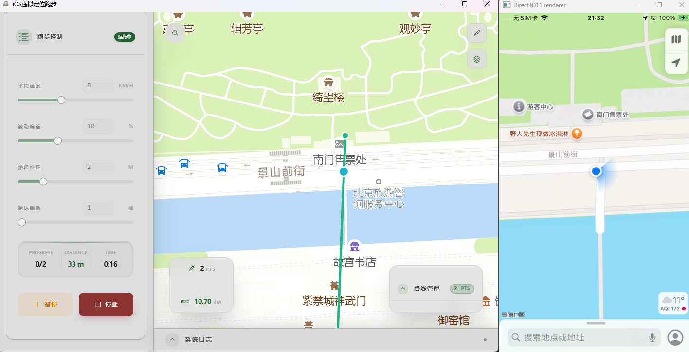
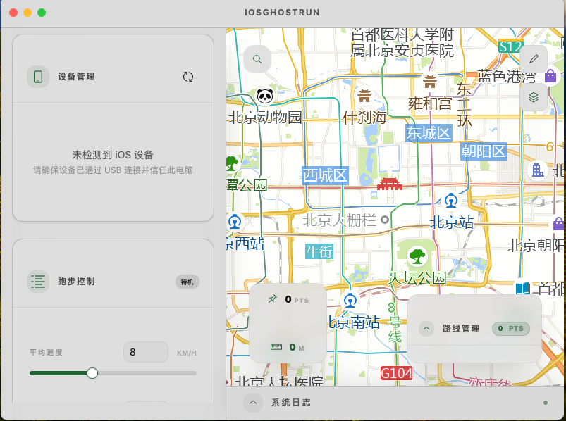

# iOSGhostRun - iOS 虚拟跑步

基于 [go-ios](https://github.com/danielpaulus/go-ios) 和 [Wails v3](https://v3.wails.io/) 开发的跨平台 iOS 虚拟跑步应用。

## 功能特性

- **虚拟跑步模拟**: 按设定速度推进定位点，模拟连续运动。
- **随机化支持**: 支持速度波动和路线偏移，模拟真实跑步。
- **地图路线编辑**: 支持手动绘制路线、撤回上一步、搜索地点、自动保存路线。
- **实时位置可视化**: 跑步过程实时显示当前位置与轨迹。
- **设备管理**: 自动检测并连接 iOS 设备，支持任意 iOS 版本。
- **跨平台桌面端**: 支持 Windows、macOS、Linux。

> **iOS 17+ 说明**：Windows 用户可在右上角「设置」中一键下载安装 Wintun，或导入官方 ZIP / 对应程序架构的 DLL。运行库安装在 EXE 同级目录；macOS、Linux 无需安装 Wintun。开发者镜像会在选择设备时自动下载。

## 截图





## 安装与运行

### 环境要求

- [Golang](https://go.dev) 1.26+
- [Bun](https://bun.sh/)
- [Wails v3](https://v3.wails.io/getting-started/installation/)

### 快速开始

```bash
# 安装依赖
cd frontend && bun install && cd ..
go mod tidy

# 开发运行
wails3 dev

# 构建发布
wails3 build   # 仅build当前架构，带 Console
wails3 package # 打包所有架构，不带 Console
```

## 使用步骤

顶部标题栏的月亮 / 太阳按钮可切换亮色和暗色界面，高德矢量地图同步切换标准 / 深色样式，并保留当前视角与路线。全新安装的暗色地图使用高德内置「极夜蓝」，可在地图右上角的图层菜单中选择「极夜蓝 / 靛青蓝 / 幻影黑」或已经配置的自定义样式；卫星图保留原始影像颜色。首次使用跟随系统主题，手动选择后会保存。

深色界面采用 Apple 地图风格的冷调深灰和蓝色操作元素。可按[配色参考](docs/apple-inspired-dark.md)创建自己的底图，在「设置 → 深色地图外观」填写样式 ID（支持完整 `amap://styles/…` 地址）。[高德要求自定义样式 ID 和 Key 属于同一账号](https://lbs.amap.com/faq/js-api/map-js-api/layer/44215)；验证失败时地图自动回退「极夜蓝」并提示。升级时会把旧版保存的「冷灰夜色」选择迁移为个人自定义样式。

界面主题和地图样式保存在应用数据目录的 `map-appearance.json`，设置中可导入、导出外观档案。档案不包含高德 Key 或安全密钥；换电脑或换账号时需单独填写对应的地图凭据。升级时把新 EXE 放在原 EXE 旁边，保留原有 `iOSGhostRun-data` 文件夹，首次启动会迁移旧版外观选择。若改放到其他目录，则会使用新目录的数据文件夹。跨账号复用自定义样式，需要在高德 GeoHUB 共享、复制到对方账号，使用复制后生成的新样式 ID。

首次使用请打开右上角「设置」，填写高德地图的 **Web 端（JS API）Key** 和对应的 **安全密钥（securityJsCode）**。程序内置安全代理，自动监听本机的可用端口、转发高德请求并附加安全密钥，无需另外部署服务器或填写代理地址。保存后地图自动重新加载，无需编辑 `frontend/.env` 或重新编译。此前使用外部代理配置的用户会保留原 Key，需要在设置中补充对应的安全密钥。

左侧控制面板和设置中会显示「地图服务」状态（运行中、待配置、已停止、异常）、本机监听地址、转发次数和连接错误；可在设置中点击「重启服务」。本地代理仅监听 `127.0.0.1`，每次启动使用新的随机访问路径，应用退出时关闭。安全密钥保存在后端配置中，不回填到前端，也不随地图初始化配置传给 JS SDK；再次保存同一 Key 时可留空以保留原密钥。服务状态表示本地代理的运行情况，地图能否加载还取决于高德 Key 的类型、权限和有效性。

地图设置保存在应用数据目录的 `map-settings.json` 中（Windows 为 EXE 旁边的 `iOSGhostRun-data`，macOS 为用户 Application Support 下的 `iosghostrun`），更新程序后继续保留。Windows 的 `wintun.dll` 与 `WINTUN-LICENSE.txt` 应和 EXE 一起保留；本地 DLL 导入只接受官方 Wintun 0.14.1，并检查架构和 SHA-256 摘要。

1. 连接设备: USB 连接 iOS 设备，并在设备上选择信任此电脑。
2. 刷新设备: 在应用内点击刷新，确认设备已识别。
3. 绘制路线: 进入绘制模式，添加至少 2 个路线点。
4. 配置参数: 设置速度、速度波动、偏移和循环次数。
5. 开始跑步: 点击开始，可暂停/继续/停止，结束后重置真实位置。

## 测试环境

| 平台    | 系统版本   | 设备/架构      |
| ------- | ---------- | -------------- |
| Windows | Windows 11 | x64            |
| macOS   | macOS 15.7 | x64            |
| iOS     | iOS 16.1   | iPhone 12 mini |
| iOS     | iOS 26.0.1 | iPhone SE 2020 |

## 许可证与免责声明

[MIT License](LICENSE)

界面使用小米提供的 [MiSans 字体](https://hyperos.mi.com/font/zh/)，字体文件遵循小米的 [MiSans 字体知识产权许可协议](https://hyperos.mi.com/font/zh/download/)；项目的 MIT 许可证不适用于 MiSans 字体文件。

**免责声明**：本软件仅供学习和研究使用，请自行承担使用风险。
